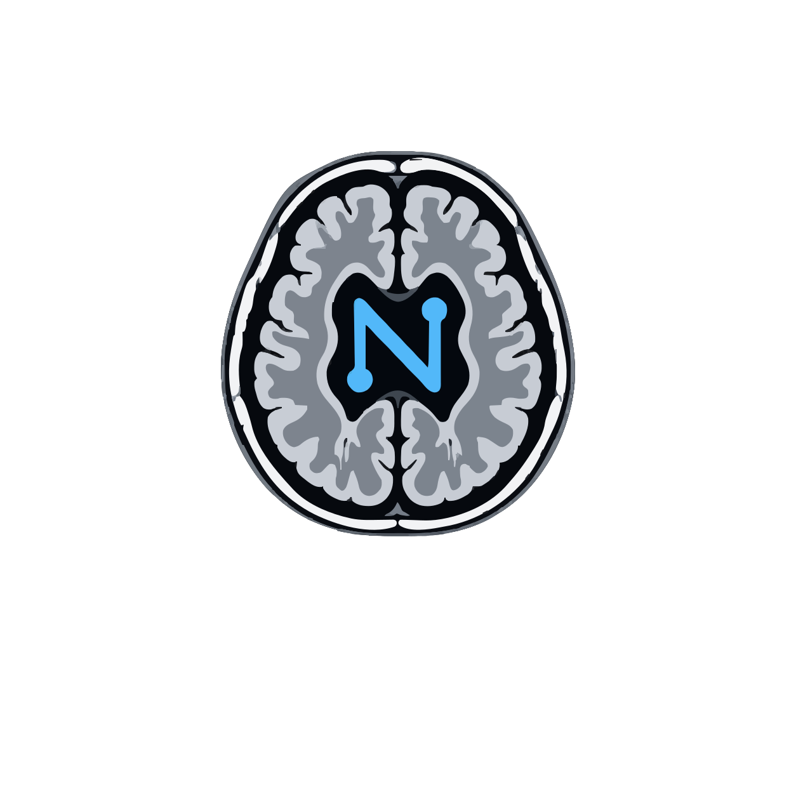

<p align="center">
  
</p>

<h1 align="center">🤖🧠 NeuroAIHub</h1>

<p align="center">
  <b>AI-driven discovery of neuroradiology datasets — browse, filter and chat with a curated, continuously updated database.</b>
</p>

<p align="center">
  <a href="https://neuroai.streamlit.app"></a>
  <a href="https://www.ajnr.org/content/early/2026/04/24/ajnr.A9363"></a>
  <a href="https://pypi.org/project/neuroaihub/"></a>
  <a href="LICENSE"></a>
</p>

**NeuroAIHub** makes **neuroradiology dataset discovery** easier, smarter, and always up to date. At its core is a
**curated, continuously updated database of 368 public neuroradiology datasets** in seven categories, described by
22 metadata fields and reviewed and expanded by the NeuroAIHub team and community. Explore it on the
**website** — browse, filter, compare and plot — or **chat with the NeuroAI agent**, which understands natural-language
questions and answers them from the database. Whether you're a **clinician**, **scientist**, or **AI developer**,
NeuroAIHub helps you find the right datasets — **quickly, accurately, and effortlessly**. 🚀

---

# 🚀 **Getting Started**

NeuroAIHub offers two ways to explore neuroradiology datasets.

### 🌐 **1. The Website**

👉 **[neuroai.streamlit.app](https://neuroai.streamlit.app)** — nothing to install.

| | |
|---|---|
| 🗂️ **Browse & filter** | Pick a category or combine filters (disease, modality, access, segmentation masks, healthy controls, publication year), open the full metadata of any dataset, and download the results as CSV. |
| 📊 **Visualize** | Generate quick charts of the database — datasets per year, modality, disease, country, access and more. |
| 💬 **Chat with NeuroAI** | Ask in plain language for recommendations, comparisons, custom counts and plots. Connect any OpenAI-compatible model — e.g. a free model on [OpenRouter](https://openrouter.ai). |

### 💻 **Offline Installation**

Run the same website on your own machine (for example if the hosted version is temporarily unavailable):

```bash
git clone https://github.com/NeuroAIHub-Registry/NeuroAIHub
cd NeuroAIHub/web_app
pip install -r requirements.txt
streamlit run main.py
```

### 📦 **2. The Python Package**

```bash
pip install neuroaihub
```

The package contains the **NeuroAI Chat Agent** — the same agent as on the website — and always reads the
**latest database from this repository**, so new datasets are available without updating the package.

```python
from neuroaihub import NeuroAIChatAgent

agent = NeuroAIChatAgent(
    api_key="YOUR_API_KEY",
    base_url="https://openrouter.ai/api/v1",            # leave out for OpenAI
    model="nvidia/nemotron-3-super-120b-a12b:free"      # e.g. "gpt-5" with OpenAI
)

result = agent.chat("I’m planning a deep learning project on brain tumor segmentation. Which datasets would you recommend?")
agent.display(result)          # answer, result table and charts (rich output in Jupyter)

result = agent.chat("Which of those are open access?")   # follow-up questions use the previous results
result["data"]                 # the matching datasets as a pandas DataFrame
```

Work with the database directly:

```python
from neuroaihub import load_database
dataframes, combined_df, categories = load_database()     # one DataFrame per category + all combined
```

---

# 🎥 **Demo Video**

Want a quick overview of how NeuroAIHub works?

👉 **[Watch the NeuroAIHub demo video](https://drive.google.com/file/d/1nG2cF6pN9CP4lofSQuYMhFwRZCHMdxeM/view?usp=drive_link)**

---

# 🎯 **Key Features**

• **Comprehensive Neuroradiology Dataset Database:** A centrally curated database of public neuroradiology datasets in seven categories — Neurodegenerative, Neoplasm, Cerebrovascular, Psychiatric, Spinal, Neurodevelopmental and Other. The foundational entries were extracted with a multi-reviewer approach to ensure accuracy, completeness and consistency, and the database is continuously expanded and corrected through monthly updates.

• **Conversational Dataset Exploration with the NeuroAI Chat Agent:** Ask for category summaries, find datasets with natural-language criteria, get recommendations for a research project, compare datasets and create charts. Every dataset name, number and link in an answer is computed from the database — the agent does not answer from memory.

• **Interactive Website:** Fast, structured exploration — browse by category, combine filters, inspect full metadata, download results and plot the database — plus the integrated NeuroAI chat for more complex questions.

• **Open-Source Python Package:** The NeuroAI Chat Agent and the database are available as a Python package that always uses the latest version of the database, enabling programmatic access, local execution and full transparency.

• **Multi-Model Support:** Works with any OpenAI-compatible provider whose model supports tool calling (OpenAI, OpenRouter including free models, and others) — just provide an API key, base URL and model name.

• **Community-Friendly and Extensible:** Anyone can submit a missing dataset in two minutes, report issues, or propose improvements.

---

# 🤝 **Community Contributions**

NeuroAIHub grows with the community, and we warmly welcome contributions of all kinds.

**• Submit a dataset with the online form (easiest)**

Know a neuroradiology dataset that is not yet included? Fill in the short **[dataset submission form](https://docs.google.com/forms/d/e/1FAIpQLSfCCAqT9-tx4he0kocomjPqSv4TsO96qrbroEiisgmyQOod_g/viewform)** — only six questions are required, and the team completes the remaining metadata.

**• Submit datasets via Pull Request**

Add the dataset as a new row to the CSV file of its category in [`web_app/assets/datasets/`](web_app/assets/datasets), following the same 22 columns, and open a Pull Request. The team reviews every submission before adding it to the database.

**• Other ways to contribute**

Report missing or incorrect metadata, improve the code, strengthen the chat agent, enhance the website, or share feedback through [GitHub Issues](https://github.com/NeuroAIHub-Registry/NeuroAIHub/issues).

All contributors whose datasets are accepted are acknowledged in this repository.

---

# 👤 **Project Lead**

<table>
  <tr>
    <td width="170" valign="top">
      
    </td>
    <td valign="top">
      <h3>Benyamin Gheiji</h3>
      MD Candidate · ML Engineer · Medical Imaging AI Researcher
      <br /><br />
      <a href="https://benyamin-gheiji.github.io/"></a>
      <a href="https://www.linkedin.com/in/benyamin-gheiji-4a0668260"></a>
      <a href="https://scholar.google.com/citations?user=0Fdy24gAAAAJ&hl=en"></a>
      <a href="https://github.com/benyamin-gheiji"></a>
      <a href="mailto:benyamingheiji@gmail.com"></a>
    </td>
  </tr>
</table>

---

# 🙏 **Acknowledgements**

A heartfelt thank you to everyone who contributed to NeuroAIHub.

Special appreciation to my colleagues [**Sina Moradi**](https://www.linkedin.com/in/sinusealpha), [**Mahsa Vatanparast**](https://www.linkedin.com/in/mahsa-vatanparast-24314b2a7), [**Sana Shokrani**](https://www.linkedin.com/in/sana-shokrani-6392512a4), [**Mohammad Aref Bagherzadeh**](https://www.linkedin.com/in/mohammad-aref-bagherzadeh-3a3245a2), [**Danial Elyassirad**](https://www.linkedin.com/in/danial-elyassirad-6aa625245), [**Oluwatobi Iyanuoluwa Akinmuleya**](https://www.linkedin.com/in/akinmuleya), [**Sina Goodarzi**](https://www.linkedin.com/in/sina-goodarzi-6610212a2), and [**Mahsa Heidari-Foroozan**](https://www.linkedin.com/in/mahsa-heidari-foroozan-99969b19a), whose efforts in discovering datasets and extracting metadata were essential in building the foundational database.

Additional thanks to [**Dr. Mana Moassefi**](https://www.linkedin.com/in/mana-moassefi-a6b589119/), [**Dr. Jeffrey Rudie**](https://www.linkedin.com/in/jeff-rudie/), [**Dr. Evan Calabrese**](https://scholar.google.com/citations?user=gNEakpEAAAAJ&hl=en), and [**Dr. Rajan Jain**](https://scholar.google.com/citations?user=Wgi5-XMAAAAJ&hl=en) for their invaluable comments and thoughtful feedback, which helped refine and strengthen the project.

Many thanks to [**Mohammad Hossein Kazemi**](https://thisiskazzi.github.io/), [**Sana Shokrani**](https://www.linkedin.com/in/sana-shokrani-6392512a4), and [**Danial Elyassirad**](https://www.linkedin.com/in/danial-elyassirad-6aa625245) for their help in continuously updating the database and making NeuroAIHub better.

A very special thanks to [**Dr. Shahriar Faghani**](https://www.linkedin.com/in/shahriar-faghani-7b468082) for his visionary idea that inspired this project, and for his invaluable mentorship, encouragement, and guidance. His influence was instrumental in transforming NeuroAIHub from a concept into a working ecosystem.

---

# 📄 **Research Paper**

NeuroAIHub is published in the **American Journal of Neuroradiology (AJNR)**. For detailed methodology, results, and
technical insights, see the paper:

👉 **[Read the paper in AJNR](https://www.ajnr.org/content/early/2026/04/24/ajnr.A9363)**

---

# ⭐ **Support NeuroAIHub**

If you find NeuroAIHub useful or inspiring:

- 🌟 **Star the repository** — it truly motivates future development
- 🤝 **Contribute** — add datasets, improve the code, enhance the website
- 📣 **Share** with peers in AI and radiology

Together, we can make neuroradiology dataset discovery **faster, smarter, and more accessible** for everyone. 🚀
